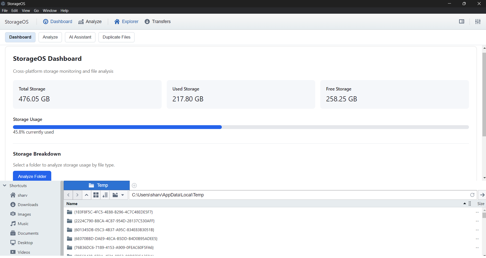
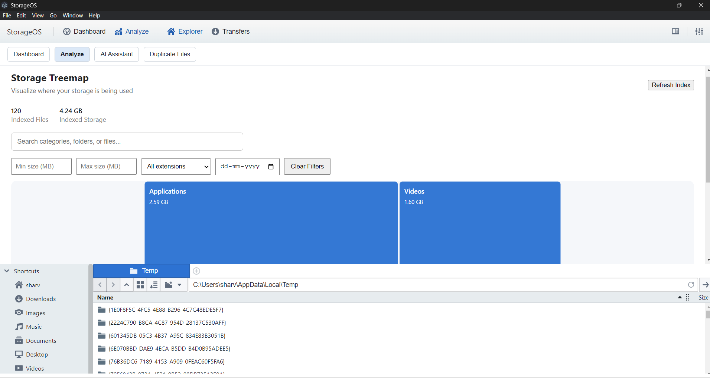
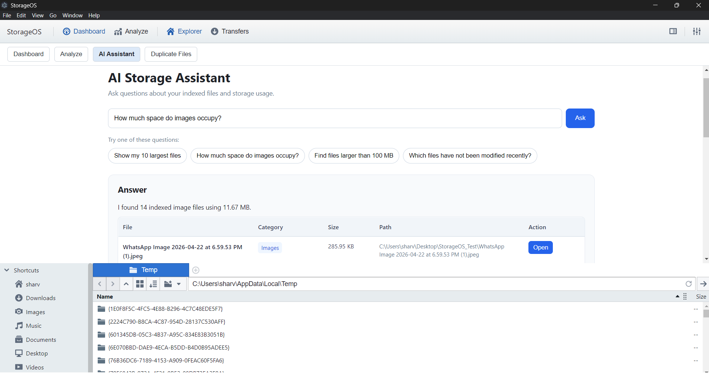
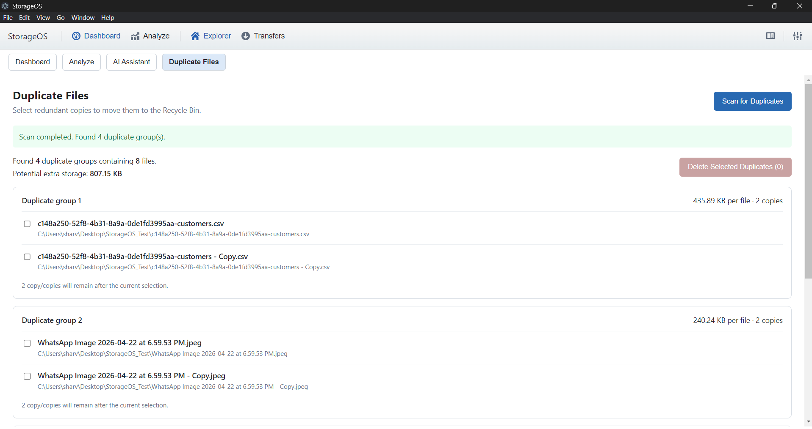

# StorageOS: Intelligent Storage Management

*Making local storage easier to explore, understand, and manage.*

**An AI-powered desktop application for intelligent file discovery, storage visualization, and duplicate-file analysis.**

## 1. Project Overview

StorageOS is an intelligent desktop storage management application designed to simplify how users explore, analyze, and manage files on their local systems. By combining interactive storage visualization, advanced file filtering, duplicate detection, and a locally integrated AI assistant, StorageOS transforms conventional file browsing into a more structured and accessible storage-analysis experience.

Built using Electron, React, and TypeScript, the application brings together desktop-level file-system access and a modern user interface. Its local AI integration enables users to ask natural-language questions about indexed files, making file discovery and storage analysis more intuitive.

The primary objective of StorageOS is to help users understand how their storage is utilized, locate relevant files efficiently, identify redundant data, and make better-informed storage-management decisions.

## 2. Key Features

### Intelligent Storage Visualization
- Interactive treemap for visualizing indexed storage by file category and folder.
- Storage summaries displaying indexed file counts and total indexed storage.
- Folder-level navigation and contextual file exploration.
- Visual representation of storage distribution to help identify space-intensive categories.

### Advanced File Search and Filtering
- Search indexed files using filenames, keywords, extensions, and file paths.
- Filter results by minimum and maximum file size.
- Filter by file extension and modification date.
- Combine search terms and filters to narrow down relevant results.

### AI-Powered Storage Assistant
- Natural-language interaction for storage-related queries.
- Search for files using filenames, keywords, and common extensions.
- Identify large files and files that have not been modified recently.
- Retrieve relevant file metadata, including category, size, and location.
- Open matching files directly from search results.
- Local language-model integration through Ollama and Qwen3 1.7B.

### Duplicate File Detection
- Identify potential duplicate candidates by grouping files with matching sizes.
- Verify duplicate content using SHA-256 hashing.
- Display duplicate groups and potential storage savings.
- Report scan progress during duplicate analysis.
- Allow users to select duplicate copies for removal.
- Move selected files to the Windows Recycle Bin through the Electron shell integration.

### Desktop Application Integration
- Native Windows desktop experience powered by Electron.
- React-based interface with TypeScript for structured development.
- Local metadata persistence using SQLite-compatible storage through sql.js.
- Electron IPC communication between the renderer and main processes.
- File-system scanning and metadata retrieval for indexed storage analysis.

## 3. Technology Stack

| Technology | Purpose |
|---|---|
| Electron | Desktop application framework and operating-system integration |
| React | Component-based user interface |
| TypeScript | Type-safe application development |
| sql.js | Local SQLite-compatible metadata storage |
| Node.js | Backend operations and file-system processing |
| Ollama | Local language-model runtime |
| Qwen3 1.7B | Natural-language query interpretation |
| Webpack | Application bundling and build workflow |
| SHA-256 | Duplicate-file content verification |

## 4. System Architecture

StorageOS follows a desktop architecture that separates the user interface, application logic, and persistent metadata.

**Renderer Layer**
- Displays the dashboard, storage treemap, file filters, duplicate results, and AI assistant.
- Collects user queries and presents results.

**Electron Main Process**
- Handles operating-system interactions and IPC requests.
- Coordinates folder scanning, file opening, and duplicate-file operations.
- Connects renderer requests to storage and assistant logic.

**Storage and Metadata Layer**
- Maintains indexed file metadata, including names, paths, sizes, categories, extensions, and modification timestamps.
- Supports retrieval and analysis of indexed files.
- Persists metadata in a local database.

**Local AI Layer**
- Uses Ollama to communicate with the Qwen3 1.7B language model.
- Interprets natural-language questions that are not handled by dedicated storage-query rules.
- Works alongside deterministic application logic for storage-specific operations.

## 5. How It Works

1. **Select and scan:** Choose a folder to analyze.
2. **Index metadata:** Collect file information and save it in the local database.
3. **Analyze storage:** Explore indexed files using category visualization and filters.
4. **Ask questions:** Use the AI assistant to search for files and request storage insights.
5. **Detect duplicates:** Compare candidate files by size and verify content with SHA-256.
6. **Take action:** Open matching files or review selected duplicates for removal.

## 6. Installation and Setup

### Prerequisites
- Windows operating system.
- Node.js and npm.
- Ollama installed locally.
- The `qwen3:1.7b` model downloaded through Ollama for local AI functionality.

### Step 1: Clone or Download the Project

```bash
git clone <your-repository-url>
cd storage-manager
```

If the project is already on your computer, open its root directory in a terminal.

### Step 2: Install Dependencies

```bash
npm install
```

### Step 3: Download the Local AI Model

```bash
ollama pull qwen3:1.7b
```

Ensure the Ollama service is running before testing AI responses.

### Step 4: Build the Application

```bash
npm run build
```

Wait for Webpack compilation and TypeScript checking to complete successfully.

### Step 5: Launch StorageOS

```bash
npx electron .
```

## 7. Usage Guide

1. Launch StorageOS.
2. Open the Analyze section and scan a folder to index its files.
3. Explore storage distribution through the treemap.
4. Apply search terms and advanced filters to find specific files.
5. Open AI Assistant and ask questions such as:
   - `Find my PDF files`
   - `Show my 10 largest files`
   - `Find files larger than 100 MB`
   - `Which files have not been modified recently?`
6. Open Duplicate Files to scan a folder and review detected duplicates.
7. Review files carefully before moving any selected duplicates to the Recycle Bin.

## 8. Security and Privacy Considerations

- File metadata is stored locally by the application.
- The language model runs locally through Ollama, avoiding the need for a paid hosted LLM API for the configured assistant workflow.
- File deletion actions should be reviewed carefully before confirmation.
- File discovery and analysis depend on which folders have been indexed.
- Local AI responses may be imperfect; verify important results before acting on them.

## 9. Current Scope and Limitations

- Storage analysis operates on indexed file metadata and may not reflect unindexed folders.
- Natural-language interpretation depends on the installed local language model and application query handling.
- AI-generated explanations are not guaranteed to be correct.
- Performance depends on the computer's available memory, processor, and storage.
- Cloud synchronization, automated backup and restore, and automatic storage cleanup are outside the currently implemented scope.

## 10. Future Enhancements

Potential future improvements include:
- More robust semantic file search.
- Smart storage recommendations based on usage patterns.
- Configurable indexing schedules and incremental scanning.
- Improved file organization suggestions.
- Exportable storage reports and analysis summaries.
- Additional safeguards and audit information for file-management actions.

## 11. Project Objective

StorageOS demonstrates how desktop application development, file-system processing, local metadata persistence, cryptographic hashing, interactive visualization, and local language models can be combined into a unified storage-management solution.

The project aims to make file discovery more accessible, storage utilization easier to understand, and duplicate-file analysis more efficient through an intuitive desktop experience.

## 12. License and Attribution

This project extends the upstream `react-explorer` project. Retain the original license, copyright notices, and required attribution, and document additional modifications according to the applicable license terms.

## 13. Application Screenshots

### Dashboard


### Storage Treemap


### AI-Powered Storage Assistant


### Duplicate File Detection


## License and Attribution

StorageOS extends the open-source [react-explorer](https://github.com/warpdesign/react-explorer) project, originally developed by Nicolas Ramz and distributed under the MIT License.

StorageOS includes original enhancements and modifications, including storage visualization, duplicate-file detection, advanced file filtering, and a locally powered AI storage assistant.

The original copyright notice and MIT License terms are retained in the `LICENSE` file. Additional contributions are provided subject to the applicable license terms.