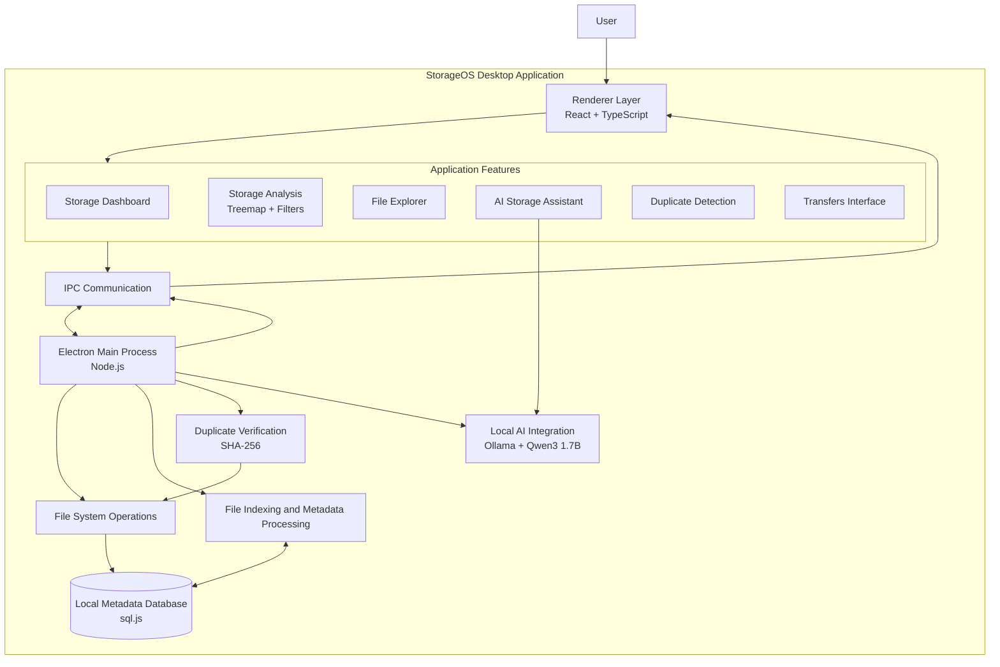
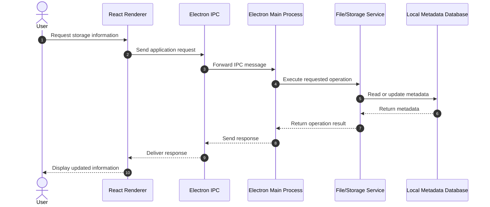
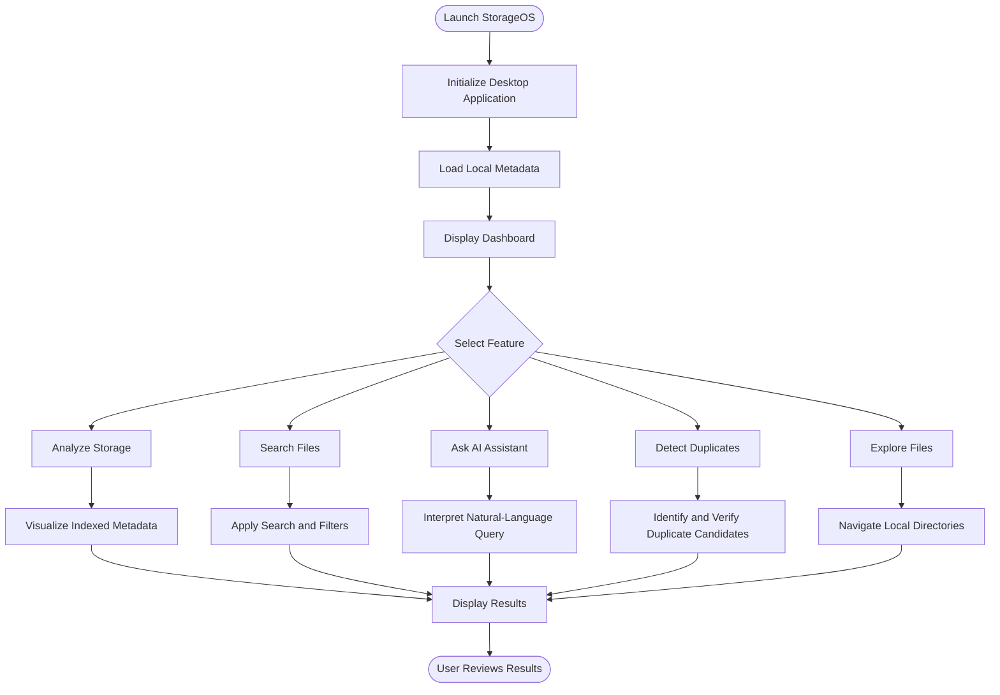
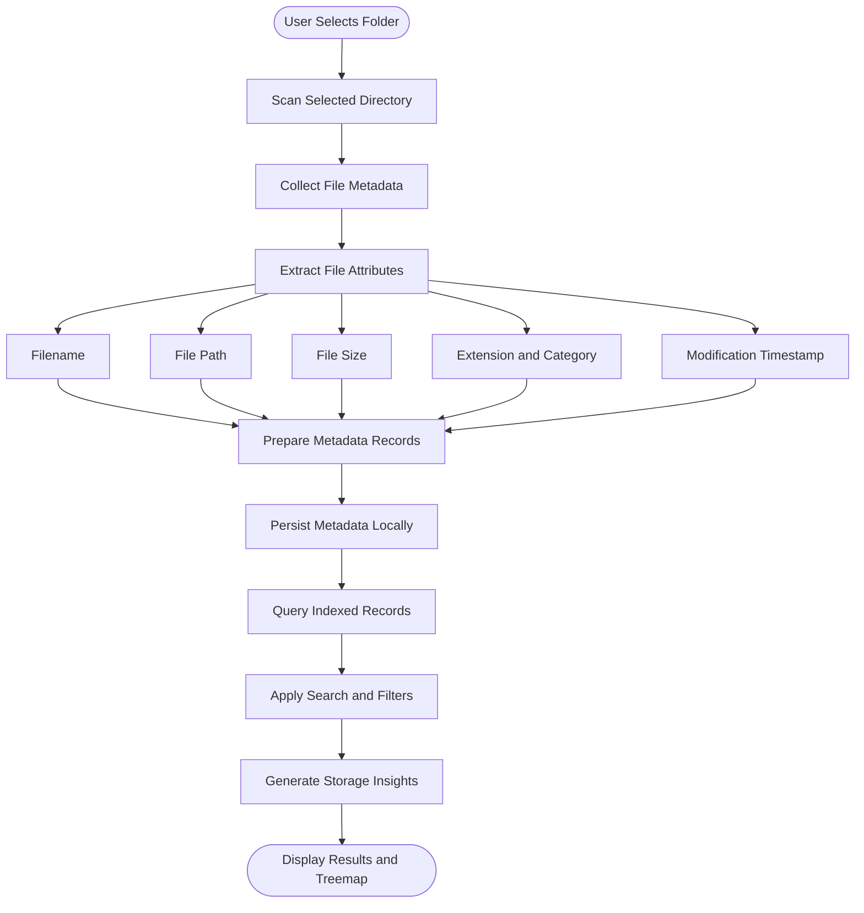
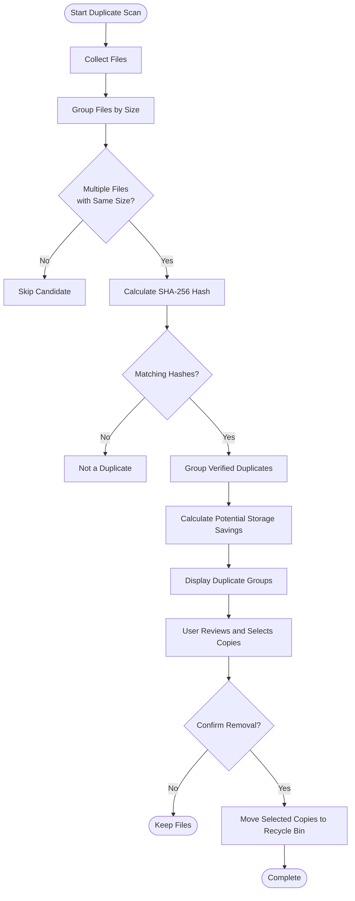
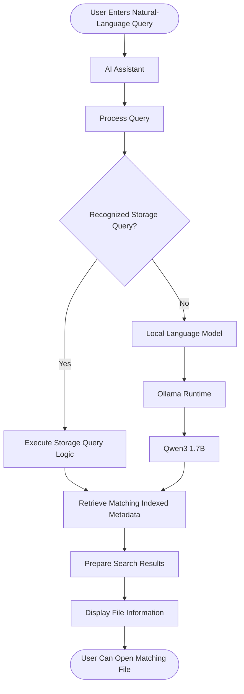
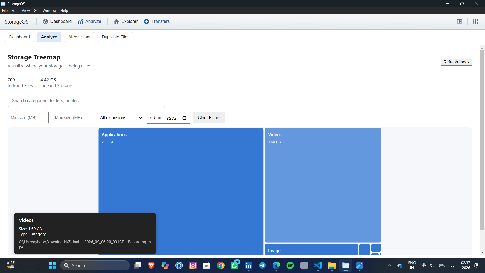
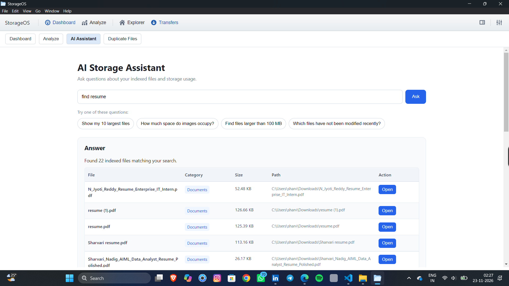
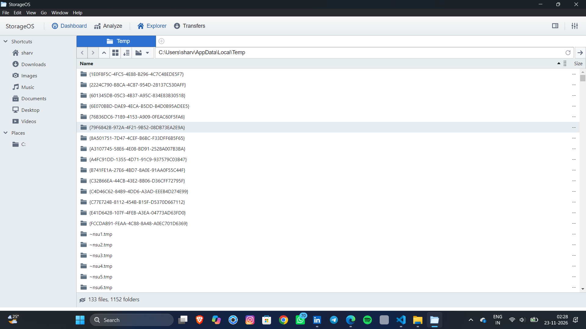

# StorageOS — Intelligent Storage Management

<p align="center">
  <strong>Making local storage easier to explore, understand, and manage.</strong>
</p>

<p align="center">
  An AI-powered desktop application for intelligent file discovery, storage visualization, advanced file filtering, and duplicate-file analysis.
</p>

<p align="center">
  <a href="https://github.com/sharvari-nadig/StorageOS/releases/tag/v4.0.0-rc.1">
    
  </a>
  
  
</p>

<p align="center">
  
  
  
  
  
</p>

<p align="center">
  <strong>Windows Installer:</strong>
  <a href="https://github.com/sharvari-nadig/StorageOS/releases/tag/v4.0.0-rc.1">StorageOS v4.0.0-rc.1 — Download Release</a>
</p>

---

## Table of Contents

- [1. Project Overview](#1-project-overview)
- [2. Problem Statement](#2-problem-statement)
- [3. Key Features](#3-key-features)
- [4. Application Architecture](#4-application-architecture)
- [5. System Workflow](#5-system-workflow)
- [6. Technical Implementation](#6-technical-implementation)
- [7. Technology Stack](#7-technology-stack)
- [8. Application Screenshots](#8-application-screenshots)
- [9. Installation and Setup](#9-installation-and-setup)
- [10. Usage Guide](#10-usage-guide)
- [11. Security and Privacy](#11-security-and-privacy)
- [12. Current Scope and Limitations](#12-current-scope-and-limitations)
- [13. Future Enhancements](#13-future-enhancements)
- [14. Project Objective](#14-project-objective)
- [15. License and Attribution](#15-license-and-attribution)

---

## 1. Project Overview

StorageOS is an intelligent desktop storage management application designed to simplify how users explore, analyze, and manage files on their local systems.

Traditional file explorers provide basic browsing capabilities but offer limited insight into storage distribution, redundant files, and intelligent file discovery.

StorageOS addresses these challenges by combining interactive storage visualization, advanced file filtering, duplicate detection, and a locally integrated AI assistant into a unified desktop application.

Built using Electron, React, and TypeScript, the application combines desktop-level file-system access with a modern, interactive user interface.

Its local AI integration enables users to ask natural-language questions about indexed files, making file discovery and storage analysis more intuitive.

The primary objective is to help users:

- Understand how their storage is being utilized.
- Visualize storage distribution across file categories.
- Locate files using advanced search and filtering.
- Discover files through natural-language queries.
- Identify redundant files and potential storage savings.
- Explore and manage local files through a desktop interface.

## 2. Problem Statement

As the amount of data stored on personal computers increases, managing local storage becomes increasingly difficult.

Users often encounter the following challenges:

- Difficulty understanding which categories consume the most storage.
- Time-consuming manual searches across folders and directories.
- Limited visibility into large and rarely modified files.
- Multiple copies of the same files occupying unnecessary space.
- Lack of intelligent, context-aware file discovery.

StorageOS provides an integrated approach to these problems through storage visualization, metadata indexing, intelligent search, local AI assistance, and duplicate-file analysis.

## 3. Key Features

### 3.1 Intelligent Storage Visualization

- Interactive treemap for visualizing indexed storage by file category and folder.
- Storage summaries displaying indexed file counts and total indexed storage.
- Folder-level navigation and contextual file exploration.
- Visual representation of storage distribution to identify space-intensive categories.

### 3.2 Advanced File Search and Filtering

- Search indexed files using filenames, keywords, extensions, and file paths.
- Filter results by minimum and maximum file size.
- Filter by file extension and modification date.
- Combine search terms and filters to narrow down relevant results.

### 3.3 AI-Powered Storage Assistant

- Natural-language interaction for storage-related queries.
- Search for files using filenames, keywords, and common extensions.
- Identify large files and files that have not been modified recently.
- Retrieve relevant file metadata, including category, size, and location.
- Open matching files directly from search results.
- Local language-model integration through Ollama and Qwen3 1.7B.

### 3.4 Duplicate File Detection

- Identify potential duplicate candidates by grouping files with matching sizes.
- Verify duplicate content using SHA-256 hashing.
- Display duplicate groups and potential storage savings.
- Report scan progress during duplicate analysis.
- Allow users to select duplicate copies for removal.
- Move selected files to the Windows Recycle Bin through Electron shell integration.

### 3.5 Desktop Application Integration

- Native Windows desktop experience powered by Electron.
- React-based interface with TypeScript for structured development.
- Local metadata persistence using SQLite-compatible storage through sql.js.
- Electron IPC communication between the renderer and main processes.
- File-system scanning and metadata retrieval for indexed storage analysis.

---

## 4. Application Architecture

StorageOS follows a layered desktop application architecture that separates the presentation layer, operating-system integration, file-processing operations, persistent metadata, and local AI functionality.

### 4.1 High-Level Architecture



### 4.2 Architecture Components

**Renderer Layer — React and TypeScript**

Responsible for the application's user interface and user interactions.

- Displays the dashboard, treemap, file filters, duplicate results, and AI assistant.
- Collects user queries and presents results.
- Provides navigation and interactive controls.

**Electron Main Process — Node.js**

Responsible for desktop-level operations and operating-system integration.

- Handles operating-system interactions and IPC requests.
- Coordinates folder scanning, file opening, and duplicate-file operations.
- Connects renderer requests to storage and assistant logic.

**Storage and Metadata Layer — sql.js**

Maintains indexed file information for storage analysis and file discovery.

- Stores filenames, paths, sizes, categories, extensions, and modification timestamps.
- Supports metadata retrieval and filtering.
- Persists indexed metadata locally.

**Local AI Layer — Ollama and Qwen3 1.7B**

Provides natural-language interaction with indexed storage information.

- Receives storage-related user queries.
- Supports natural-language file discovery.
- Works alongside deterministic application logic for storage-specific operations.

### 4.3 Renderer–Main Process Communication

Electron IPC separates renderer-side user interactions from privileged desktop operations.



This communication model allows the React interface to interact with file-system functionality through the Electron main process.

---

## 5. System Workflow

### 5.1 Overall Application Workflow



### 5.2 File Indexing and Storage Analysis

The indexing workflow collects file metadata and makes it available for subsequent analysis.



### 5.3 Duplicate Detection Workflow

Duplicate detection uses file size to identify candidate groups and SHA-256 hashing to verify matching content.



### 5.4 AI-Powered File Discovery Workflow



*The diagram represents the application's high-level query workflow; the local model is used alongside application-defined storage-query logic.*

---

## 6. Technical Implementation

### 6.1 File System Indexing

StorageOS scans selected directories and extracts metadata from available files.

The metadata includes:

- Filename
- Absolute file path
- File size
- File extension
- File category
- Last modification timestamp

The extracted information is stored locally and used by the application's search, filtering, visualization, and AI-assisted discovery features.

### 6.2 Storage Visualization

The Analyze interface uses indexed metadata to present storage distribution through an interactive treemap.

The visualization helps users:

- Understand storage distribution across categories.
- Identify categories consuming significant space.
- Explore indexed files and folders.
- Search and filter file records.

### 6.3 Advanced Search and Filtering

The application supports file discovery through metadata-based filtering.

Available filtering dimensions include:

- Filename and keyword.
- File extension.
- Minimum file size.
- Maximum file size.
- Modification date.
- File path.

Combining these filters enables more targeted file discovery.

### 6.4 Local AI Integration

StorageOS integrates a locally running language model through Ollama.

**Configured model:** Qwen3 1.7B

The assistant supports natural-language questions about indexed files and storage-related information.

Example queries:

```text
Find my PDF files.
Show my 10 largest files.
Find files larger than 100 MB.
Which files have not been modified recently?
How much space do images occupy?
```

The application combines its storage-query logic with local language-model interpretation to support file discovery.

### 6.5 Duplicate Verification Using SHA-256

Duplicate detection follows a two-stage approach.

**Stage 1 — Candidate Identification**

Files are grouped by size to identify potential duplicate candidates.

**Stage 2 — Content Verification**

SHA-256 hashing is used to verify whether candidate files contain matching content.

This avoids treating files as duplicates solely because they share the same filename or file size.

Selected duplicate copies can be moved to the Windows Recycle Bin after user review.

### 6.6 Local Metadata Persistence

StorageOS uses sql.js for SQLite-compatible metadata persistence.

The local database stores indexed file information and supports subsequent retrieval and analysis.

The application can use this metadata without requiring a remote database service.

---

## 7. Technology Stack

| Technology | Purpose |
|---|---|
| Electron | Desktop application framework and operating-system integration |
| React | Component-based user interface |
| TypeScript | Type-safe application development |
| Node.js | Backend operations and file-system processing |
| sql.js | SQLite-compatible local metadata persistence |
| Ollama | Local language-model runtime |
| Qwen3 1.7B | Natural-language query interpretation |
| Webpack | Application bundling and build workflow |
| SHA-256 | Duplicate-file content verification |

---

## 8. Application Screenshots

The following screenshots showcase the major interfaces and functionality of StorageOS.

### 8.1 StorageOS Dashboard

Displays total storage, used storage, free storage, storage utilization, and folder-analysis options.


### 8.2 Analyze — Storage Treemap

Visualizes indexed storage distribution across file categories and helps users understand where their storage is being used. Includes search and filtering options for exploring indexed files.



### 8.3 AI-Powered Storage Assistant

Allows users to search indexed files and ask natural-language questions about their storage. Displays matching files with relevant metadata and direct open actions.



### 8.4 Duplicate File Detection

Identifies duplicate files, displays duplicate groups, and estimates potential storage savings. Users can review duplicate copies before selecting them for removal.


### 8.5 File Explorer

Provides a desktop interface for browsing and managing local files and folders, with navigation shortcuts and folder-level exploration.



---

## 9. Installation and Setup

### 9.1 Download the Windows Installer

The easiest way to use StorageOS is to download the pre-release installer.

**[Download StorageOS v4.0.0-rc.1 — Windows Installer](https://github.com/sharvari-nadig/StorageOS/releases/tag/v4.0.0-rc.1)**

Installation steps:

1. Open the GitHub release page.
2. Navigate to the Assets section.
3. Download `StorageOS.Setup.4.0.0-rc.1.exe`.
4. Run the installer.
5. Follow the installation instructions.
6. Launch StorageOS.

**Platform:** Windows

**Release version:** v4.0.0-rc.1

**Release channel:** Pre-release

**AI requirement:** Ollama and the configured Qwen3 1.7B model must be installed locally for AI functionality.

### 9.2 Run from Source

#### Prerequisites

- Windows operating system.
- Node.js and npm.
- Ollama installed locally.
- Qwen3 1.7B model downloaded through Ollama.

#### Step 1: Clone the Repository

```bash
git clone https://github.com/sharvari-nadig/StorageOS.git
cd StorageOS
```

#### Step 2: Install Dependencies

```bash
npm install
```

#### Step 3: Download the Local AI Model

```bash
ollama pull qwen3:1.7b
```

Ensure the Ollama service is running before testing AI responses.

#### Step 4: Build the Application

```bash
npm run build
```

Wait for Webpack compilation and TypeScript checking to complete successfully.

#### Step 5: Launch StorageOS

```bash
npx electron .
```

### 9.3 Build a Windows Installer

For the configured Windows distribution workflow:

```bash
npm run dist-win
```

This runs the production Webpack build and the configured electron-builder Windows packaging process.

---

## 10. Usage Guide

1. Launch StorageOS.
2. Open the Analyze section and scan a folder to index its files.
3. Explore storage distribution through the treemap.
4. Apply search terms and advanced filters to find specific files.
5. Open AI Assistant and ask questions such as:
   - Find my PDF files.
   - Show my 10 largest files.
   - Find files larger than 100 MB.
   - Which files have not been modified recently?
6. Open Duplicate Files to scan a folder and review detected duplicates.
7. Review files carefully before moving any selected duplicates to the Recycle Bin.
8. Use Explorer to navigate local directories and access files.

---

## 11. Security and Privacy

- File metadata is stored locally by the application.
- The language model runs locally through Ollama, avoiding the need for a paid hosted LLM API for the configured assistant workflow.
- File deletion actions should be reviewed carefully before confirmation.
- File discovery and analysis depend on which folders have been indexed.
- Local AI responses may be imperfect; verify important results before acting on them.
- The application is designed for local storage management rather than cloud-based file processing.

---

## 12. Current Scope and Limitations

- Storage analysis operates on indexed file metadata and may not reflect unindexed folders.
- Natural-language interpretation depends on the installed local language model and application query handling.
- AI-generated explanations are not guaranteed to be correct.
- Performance depends on the computer's available memory, processor, and storage.
- The local AI assistant requires Ollama and the configured model.
- Cloud synchronization, automated backup and restore, and automatic storage cleanup are outside the currently implemented scope.

---

## 13. Future Enhancements

Potential future improvements include:

- More robust semantic file search.
- Smart storage recommendations based on usage patterns.
- Configurable indexing schedules and incremental scanning.
- Improved file organization suggestions.
- Exportable storage reports and analysis summaries.
- Additional safeguards and audit information for file-management actions.
- Improved storage analytics and historical usage insights.

---

## 14. Project Objective

StorageOS demonstrates how desktop application development, file-system processing, local metadata persistence, cryptographic hashing, interactive visualization, and local language models can be combined into a unified storage-management solution.

The project aims to make file discovery more accessible, storage utilization easier to understand, and duplicate-file analysis more efficient through an intuitive desktop experience.

By integrating traditional file-management capabilities with local AI assistance, StorageOS explores how intelligent desktop applications can improve everyday computing workflows.

---

## 15. License and Attribution

This project extends the upstream [react-explorer](https://github.com/nicoramz/react-explorer) project, originally developed by Nicolas Ramz and distributed under the MIT License.

StorageOS includes original enhancements and modifications, including:

- Storage visualization and analysis.
- Advanced file filtering and search.
- Duplicate-file detection and SHA-256 verification.
- Locally powered AI storage assistance.
- Desktop integration and file-management enhancements.

The original copyright notice and MIT License terms are retained in the `LICENSE` file. Additional contributions are provided subject to the applicable license terms.

---

## Project Links

| Resource | Link |
|---|---|
| GitHub Repository | [StorageOS](https://github.com/sharvari-nadig/StorageOS) |
| Windows Release | [v4.0.0-rc.1](https://github.com/sharvari-nadig/StorageOS/releases/tag/v4.0.0-rc.1) |
| Windows Installer | Available in the GitHub Release Assets |
| License | MIT, subject to upstream attribution requirements |

---

<p align="center">
  <strong>StorageOS — Making local storage easier to explore, understand, and manage.</strong>
</p>
